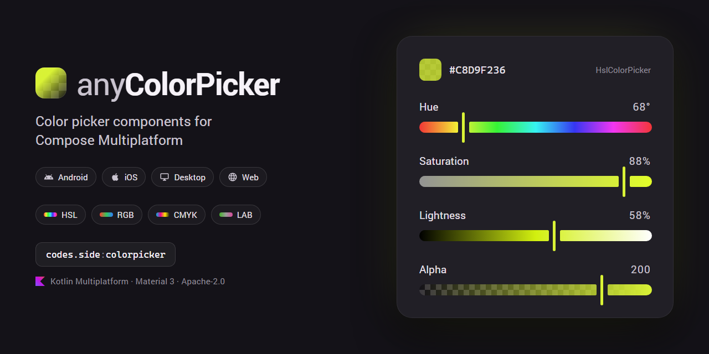
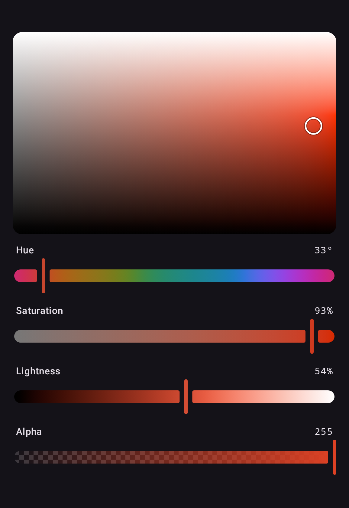
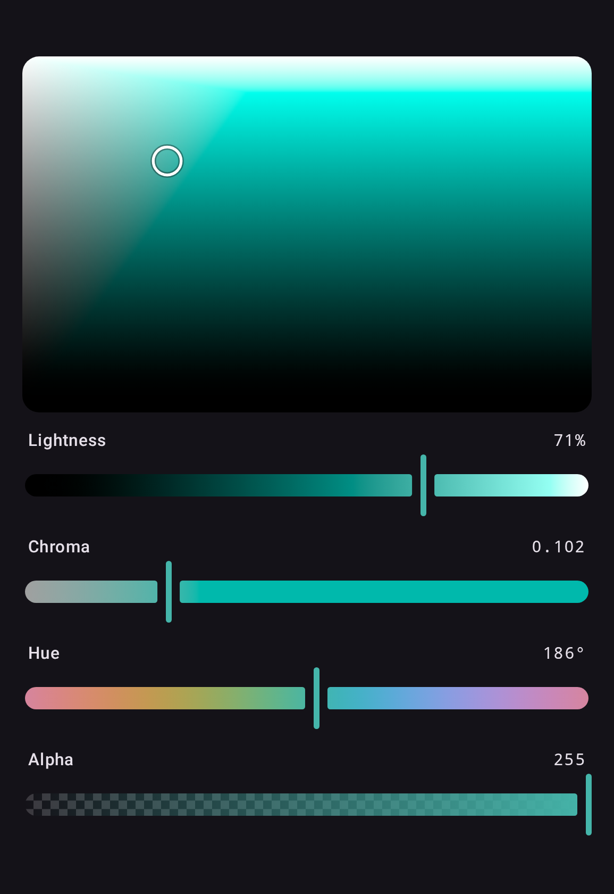
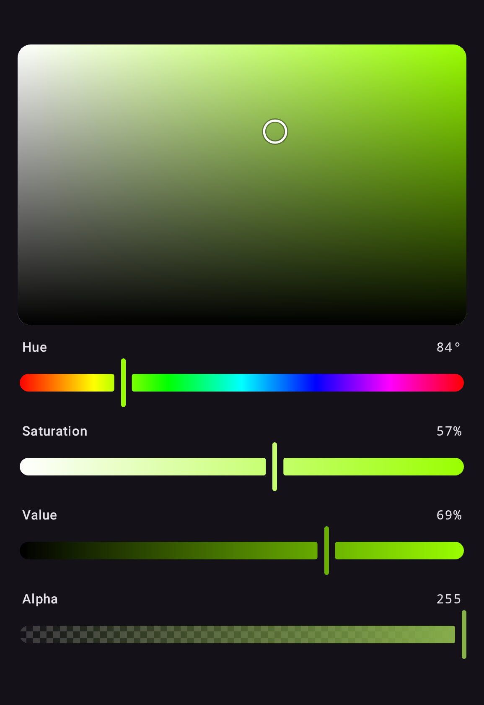
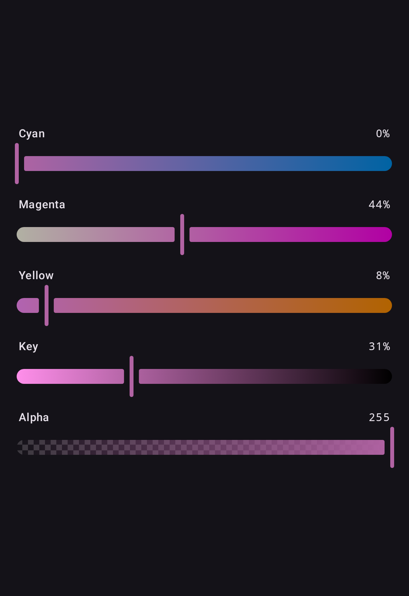

# anyColorPicker

anyColorPicker is a color picker library for Kotlin Multiplatform and Compose Multiplatform, on Android, iOS, desktop (JVM) and the web (Wasm): ready-made Material 3 pickers, and the same pickers without Material for a design system of your own. On Android it is a Jetpack Compose color picker: an Android-only app adds one dependency and needs no Kotlin Multiplatform setup.

> **This README describes 2.0.** 1.x is documented at the [v1.2.0 tag](https://github.com/side-codes/anyColorPicker/tree/v1.2.0#readme), and [Migrating from 1.x](https://side-codes.github.io/anyColorPicker/migrating-from-1x.html) maps one API onto the other.

| Okhsl                                                    | OkLCh                                                   | HSV                                                  | CMYK                                                  |
|----------------------------------------------------------|---------------------------------------------------------|------------------------------------------------------|-------------------------------------------------------|
|  |  |  |  |

Every picker, in both coloring modes: [Gallery](https://side-codes.github.io/anyColorPicker/gallery.html).

## Features

- Compose Multiplatform (Android, iOS, Desktop/JVM, Web/Wasm), and Jetpack Compose in Android-only apps
- A picker for any color space: the fifteen built in — sRGB, linear sRGB, Display P3, XYZ D65 and D50, Lab, LCH, Oklab, OkLCh, HSL, HWB, HSV, Okhsl, Okhsv and CMYK — and any an app defines
- Eleven ready-made pickers, each over a `ColorPickerState`, a `ColorValue` or a Compose `Color`
- A color model built on CSS Color 4: a `ColorValue` keeps the space it was written in, its `none` components and any value outside sRGB
- CSS color strings and hex, both ways
- CSS Color 4 gamut mapping, so a color outside sRGB is drawn with its lightness and hue held to within a just-noticeable difference
- A grey keeps its hue: dragged to grey and back, a color returns in the hue it had rather than red
- Two-dimensional planes over any two channels of a space
- Alpha channel support
- A color dialog showing the original color beside the new one, with a switcher between spaces
- Material 3 theming via `ColorPickerDefaults` and `ColorPickerTheme`
- The same components without Material, as `Basic*` components that draw what their slots draw, for any other design system
- Accessibility semantics throughout — sliders step by each channel's own unit, and planes take focus, move with the arrow keys, and offer a screen reader one named action per direction
- Words and numbers from one `ColorPickerStrings`, with numbers in the device's format — `40 %` in French, `٤٠٪` in Egyptian Arabic; reword or translate by providing your own
- RTL layout support everywhere but the planes, which map a color space rather than showing progress

## Setup

```kotlin
// build.gradle.kts
implementation("codes.side:colorpicker-material3:2.0.0")
```

In a Kotlin Multiplatform project, add it to `commonMain`:

```kotlin
kotlin {
    sourceSets {
        commonMain.dependencies {
            implementation("codes.side:colorpicker-material3:2.0.0")
        }
    }
}
```

On a design system other than Material, depend on `codes.side:colorpicker-foundation` instead: see
[Without Material](https://side-codes.github.io/anyColorPicker/without-material.html). The artifacts, targets and requirements are in [Setup and requirements](https://side-codes.github.io/anyColorPicker/setup.html).

## Quick start

```kotlin
import codes.side.color.Okhsl
import codes.side.colorpicker.material3.ColorPicker
import codes.side.colorpicker.material3.ColorSwatch
import codes.side.colorpicker.state.rememberSaveableColorPickerState

@Composable
fun MyScreen() {
    val state = rememberSaveableColorPickerState(Okhsl(250.0, 0.8, 0.6))

    Column {
        ColorPicker(state)
        ColorSwatch(color = state.color, modifier = Modifier.size(48.dp))
    }
}
```

`ColorPicker` is an Okhsl picker unless given a `space`: its lightness is perceived lightness and
its saturation is measured against sRGB, so every position is a color sRGB shows, bar a sliver just
past pure blue.
`ColorPicker(state, space = Oklch)` picks in any other space, and the named pickers,
`HslColorPicker` to `CmykColorPicker`, fix one.

A picker can equally sit over a value you hold yourself:

```kotlin
import codes.side.colorpicker.material3.HslColorPicker

var color by remember { mutableStateOf(Color(0xFF3366CC)) }

HslColorPicker(color = color, onColorChange = { color = it })
```

## Documentation

The full documentation is at **[side-codes.github.io/anyColorPicker](https://side-codes.github.io/anyColorPicker/)**:

- **Get started:** [Setup and requirements](https://side-codes.github.io/anyColorPicker/setup.html), [Gallery](https://side-codes.github.io/anyColorPicker/gallery.html)
- **Colors:** [The color model](https://side-codes.github.io/anyColorPicker/color-model.html), [Choosing a color space](https://side-codes.github.io/anyColorPicker/color-spaces.html), [Gamut mapping](https://side-codes.github.io/anyColorPicker/gamut-mapping.html), [CSS color strings and hex](https://side-codes.github.io/anyColorPicker/css-and-hex.html)
- **Components:** [Color pickers](https://side-codes.github.io/anyColorPicker/pickers.html), [Channel sliders](https://side-codes.github.io/anyColorPicker/sliders.html), [Color planes](https://side-codes.github.io/anyColorPicker/planes.html), [Custom slider thumb](https://side-codes.github.io/anyColorPicker/custom-thumb.html), [Color swatch](https://side-codes.github.io/anyColorPicker/color-swatch.html), [Color picker dialog](https://side-codes.github.io/anyColorPicker/dialog.html), [Localization](https://side-codes.github.io/anyColorPicker/localization.html), [Theming](https://side-codes.github.io/anyColorPicker/theming.html), [Without Material](https://side-codes.github.io/anyColorPicker/without-material.html)
- **State and architecture:** [State management](https://side-codes.github.io/anyColorPicker/state.html), [A value stays in its space](https://side-codes.github.io/anyColorPicker/architecture.html)
- **Guides:** [Running the samples](https://side-codes.github.io/anyColorPicker/samples.html), [Migrating from 1.x](https://side-codes.github.io/anyColorPicker/migrating-from-1x.html), [Migrating from andcolorpicker](https://side-codes.github.io/anyColorPicker/migrating-from-andcolorpicker.html)

## License

```
Copyright 2020 Illia Achour

Licensed under the Apache License, Version 2.0 (the "License");
you may not use this file except in compliance with the License.
You may obtain a copy of the License at

    http://www.apache.org/licenses/LICENSE-2.0

Unless required by applicable law or agreed to in writing, software
distributed under the License is distributed on an "AS IS" BASIS,
WITHOUT WARRANTIES OR CONDITIONS OF ANY KIND, either express or implied.
See the License for the specific language governing permissions and
limitations under the License.
```
