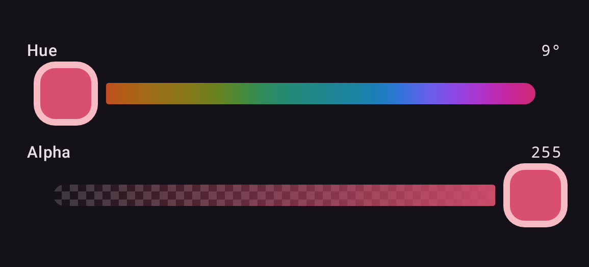

Every slider takes a `thumb` slot, so the Material 3 thumb can be replaced outright — its
size, shape and stroke are yours rather than a fixed set of dimension parameters. The slot
reads the slider's `InteractionSource`, position and thumb color from its scope, so a thumb can
also react to press and drag.



```kotlin
private val SquareThumbSize = 48.dp   // M3 minimum interactive size

@Composable
fun SquareThumb(color: Color, interaction: InteractionSource) {
    val fill = color.copy(alpha = 1f)
    val shape = RoundedCornerShape(16.dp)
    val ring = lerp(fill, Color.White, 0.6f)

    val dragged by interaction.collectIsDraggedAsState()
    val pressed by interaction.collectIsPressedAsState()
    val elevation by animateDpAsState(if (dragged || pressed) 4.dp else 0.dp)

    Box(
        Modifier
            .size(SquareThumbSize)
            .shadow(elevation, shape)
            .background(ring, shape)
            .padding(5.dp)
            .background(fill, RoundedCornerShape(11.dp))
    )
}

ChannelSlider(
    state = state,
    channel = Okhsl.H,
    thumb = { SquareThumb(state.color, interactionSource) },
    // so the track leaves room for it
    dimensions = ColorPickerDefaults.currentDimensions().copy(thumbWidth = SquareThumbSize),
)
```

The thumb needs no state parameter: `state` is already in scope at the call site, so the
composable restyles itself as the color changes. The ring is the fill lifted toward white
rather than a light-or-dark choice made at some luminance threshold — a threshold snaps
visibly the moment a drag crosses it, while this moves with the color. And because the
slot reads the slider's `InteractionSource`, the thumb can react to being dragged;
that is state a caller cannot otherwise reach, since the source is created inside the
slider.

## Thumb width

`thumbWidth` matters. The track breaks around the thumb, and it sizes that break from this
value, `ColorPickerDefaults.ThumbWidth` (the Material 3 handle) by default. A wider thumb
that does not declare its width covers the gap and sits flush against the gradient.
`thumbTrackGap` controls the clearance itself. Copying `currentDimensions()` changes the one
size and keeps whatever an enclosing `ColorPickerTheme` set for the rest. The sample app's
*Custom thumb* section runs exactly this code: see [Running the samples](samples.md).

A `thumb` given to a picker reaches every slider in it that has none of its own: see
[Color pickers](pickers.md#slots).
