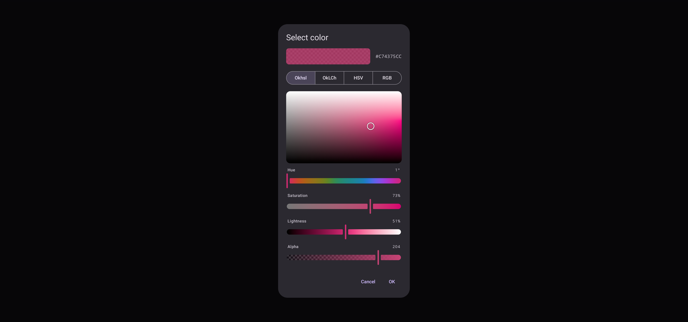
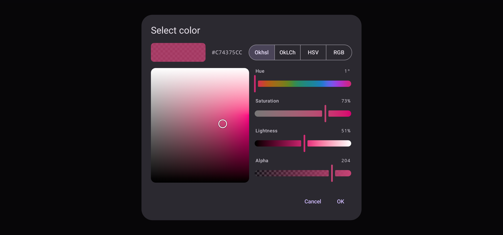

A Material 3 `AlertDialog`: the original color beside the one being edited, with its hex, a
switcher between Okhsl, OkLCh, HSV and RGB, and the picker for the space shown. The value and the
callbacks come first; everything else has defaults:

```kotlin
ColorPickerDialog(
    initialValue = state.value,
    onValueSelected = { value -> state.value = value /* and close */ },
    onDismissRequest = { /* close */ },
)
```



Switching space redraws the color without converting it. Confirming returns exactly the initial
value if nothing was edited, or if the original half of the swatch was pressed to restore it, so an
untouched Display P3 color is not clipped into sRGB on the way out. An edit of alpha alone keeps the
value's own space; any other edit returns the value in the space it was made in, and passing that
value back opens the dialog in that space again.
`ColorPickerDialog(initialColor, onColorSelected, onDismissRequest)` does the same over a Compose
`Color`, opening in the first space.

## Spaces and layout

`spaces` sets what the switcher offers: one space leaves it out, up to five are segmented buttons,
and more are a menu. The body stacks when that fits the dialog's height, and otherwise, where the
dialog is wide enough, puts the plane beside the sliders. A phone's dialog is not that wide even in
landscape, so there the body scrolls.



In-progress edits and the space shown survive configuration changes; passing a new initial value
resets the dialog.

## Slots

Every part is a slot. The title, header, switcher and buttons are handed a `ColorPickerDialogScope`,
which reads the dialog's state and confirms or dismisses it:

```kotlin
ColorPickerDialog(
    initialValue = state.value,
    onValueSelected = { /* ... */ },
    onDismissRequest = { /* ... */ },
    confirmButton = {
        TextButton(onClick = { confirm() }, enabled = dialogState.isModified) { Text("Apply") }
    },
)
```

The picker's slots are handed parts holding the dialog's own `ColorPickerState` — without it a
replacement would have nothing to read or write:

```kotlin
ColorPickerDialog(
    initialValue = state.value,
    onValueSelected = { /* ... */ },
    onDismissRequest = { /* ... */ },
    channelSlider = { part ->
        if (part.channel === Okhsl.H) {
            val hue = stringResource(Res.string.hue)
            ChannelSlider(part.state, part.channel, label = { ColorPickerDefaults.SliderLabel(hue) }, semanticLabel = hue)
        } else {
            ChannelSlider(part.state, part.channel)
        }
    },
)
```

Without Material, `BasicColorPickerDialogContent` over a `ColorPickerDialogState` draws the dialog's body in a
window of your own: see [Without Material](without-material.md).
