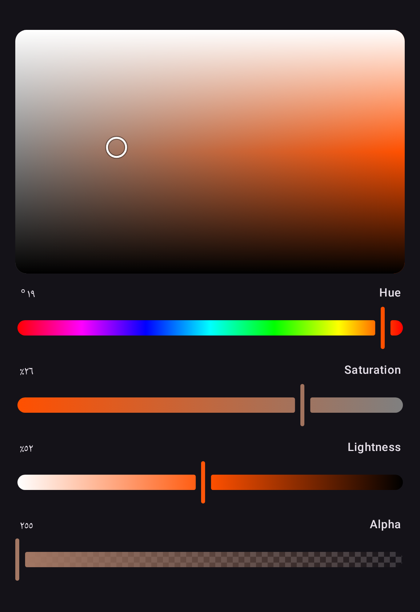

Every label, spoken description and value the components show comes from `ColorPickerStrings`:
English words, with numbers in the device's format — `40%`, `40 %` in French, `%40` in Turkish,
`٤٠٪` in Egyptian Arabic — and every slider and plane announces its value to a screen reader in
the channel's own units. To reword or translate, implement the members you need and provide the
result once, around a screen or the whole app:

```kotlin
object GermanPickerStrings : ColorPickerStrings {
    @Composable
    override fun channelName(channel: ColorChannel): String =
        if (channel === Hsl.H) stringResource(Res.string.hue) else super.channelName(channel)

    @Composable
    override fun dialogTitle(): String = stringResource(Res.string.select_color)
}

ProvideColorPickerStrings(GermanPickerStrings) {
    HslColorPicker(state = state)
}
```

Members are composable, so an implementation reads your own resources. Every member has a body
in the library's words, so a member you do not override — or one added in a later version —
keeps them. A string passed to a component still wins over the provided ones.

## Right-to-left layouts

Every component supports right-to-left layouts except the
[color planes](planes.md), which map a color space rather than showing progress.

An HSL picker in Egyptian Arabic, in an app with no strings of its own: the numbers in Arabic-Indic
digits, the sliders running from the right, the plane as in any other language, and the words the
library's English.

{ width="440" }
