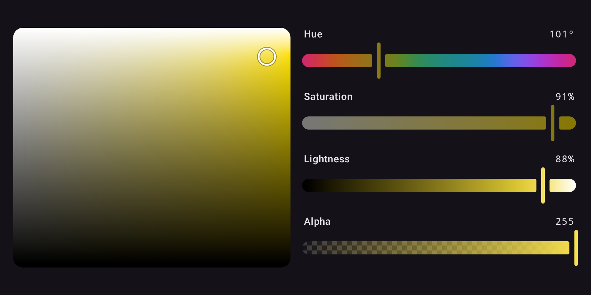

```kotlin
val state = rememberColorPickerState(Okhsl(250.0, 0.8, 0.6))

ColorPicker(state)                          // Okhsl: a plane, three sliders and alpha
ColorPicker(state, space = Oklch)           // any space, the library's or an app's
OklchColorPicker(state)                     // the same, by name
ColorPicker(
    state = state,
    space = Cmyk,
    alphaSlider = null,
    coloringMode = ColoringMode.Independent,
)
```

A picker draws a plane when its space has one hue and two other channels, then a slider for each
channel in the space's order, then alpha. The plane runs across the channel that measures
colorfulness and up the other: HSL's S × L, HSV's S × V, HWB's W × B, LCH's and OkLCh's C × L,
Okhsl's S × L and Okhsv's S × V. Moving any part leaves the color in the picker's space.

## Layout

`plane = null` and `alphaSlider = null` leave those parts out, and `orientation = Orientation.Horizontal`
puts the plane beside the sliders, in the start half:



## The named pickers

The eleven named pickers are `RgbColorPicker` (sRGB), `HslColorPicker`, `HsvColorPicker`,
`HwbColorPicker`, `LabColorPicker`, `LchColorPicker`, `OklabColorPicker`, `OklchColorPicker`,
`OkhslColorPicker`, `OkhsvColorPicker` and `CmykColorPicker`. Each is `ColorPicker` with its
space fixed and takes the same parameters. The [Gallery](gallery.md) shows each one.

## Slots

Every part of a picker is a slot, handed a part: the state, and the channel for a slider or the two
axes for the plane. Replace one to change that part alone — here, the label of one slider:

```kotlin
HslColorPicker(
    state = state,
    channelSlider = { part ->
        if (part.channel === Hsl.H) {
            val hue = stringResource(Res.string.hue)
            ChannelSlider(part.state, part.channel, label = { ColorPickerDefaults.SliderLabel(hue) }, semanticLabel = hue)
        } else {
            ChannelSlider(part.state, part.channel)
        }
    },
)
```

A replacement built from the library's sliders and planes inherits the picker's settings, so only
what you actually want to change has to be named: its colors, shapes and dimensions through the
theme, its `thumb` and `coloringMode`, and whether it is enabled. In a disabled picker the
library's sliders and planes are disabled whether or not they were told, and any other control in
a slot is refused the pointer:

```kotlin
HslColorPicker(state = state, enabled = false)   // dimmed, inert, and disabled to a screen reader
```

`thumb` reaches every slider in the picker that is not given one of its own, so
[a custom thumb](custom-thumb.md) works here too rather than only on a slider built by hand.
`onValueChangeFinished` is called when a tap or drag ends, and after each key press or screen
reader step, whichever part moved; a replaced slider or plane reports to it as well as to its own.
`ColorPickerDefaults.Plane(part)` is the plane a picker draws unless given another, sized as the
picker sizes it, for a plane slot that wraps it.

## Over a value you hold

Every picker also comes in two fully controlled forms, as Compose's `Slider(value, onValueChange)`
is: over a `ColorValue`, and over a Compose `Color`.

```kotlin
var value by remember { mutableStateOf<ColorValue>(Okhsl(250.0, 0.8, 0.6)) }
ColorPicker(value = value, onValueChange = { value = it })

var color by remember { mutableStateOf(Color(0xFF3366CC)) }
OkhslColorPicker(color = color, onColorChange = { color = it })
```

- Every change reaches the callback in the same event, as the whole new value in the picker's
  space, and the picker draws only what you pass back. Ignore the callback and the picker holds
  still; clamp or round the value and it shows the clamp or the rounding at once.
- A change of alpha alone comes back in your value's own space, so opacity never pulls a Display P3
  color into an Okhsl picker's sRGB.
- A value you pass in is drawn, and never reported back to you.
- The `Color` form keeps the exact value behind the last color it reported, so an Okhsl picker
  never steps through 8-bit sRGB, and an edit outside sRGB stays where the user put it. Hold a
  `ColorValue` to keep wide gamut and `none` on your side too.
- A value that arrives late — debounced, from a store, through a coroutine — is drawn when it
  arrives, while a drag carries on from the finger. A caller like that is better served by
  holding a `ColorPickerState` and observing it: see [State management](state.md).
