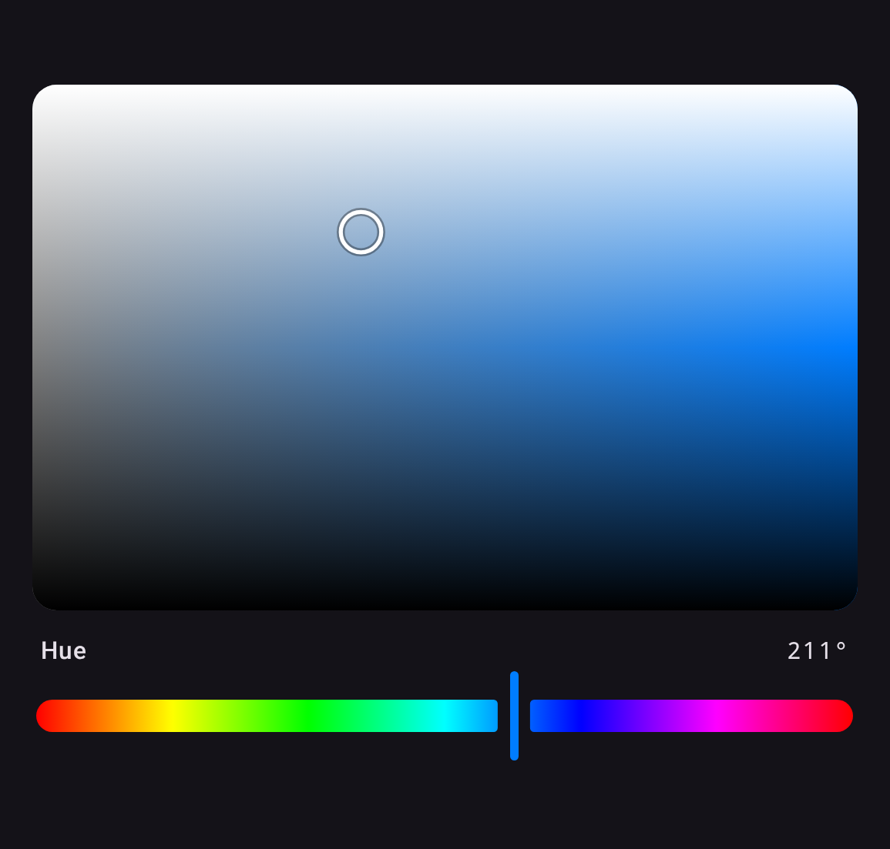
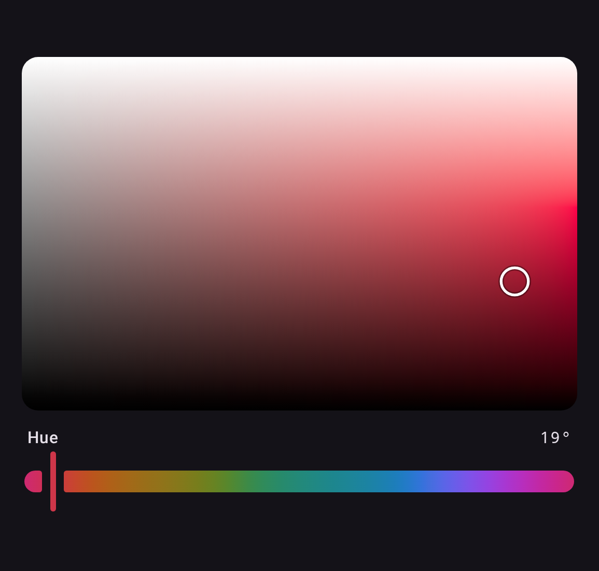
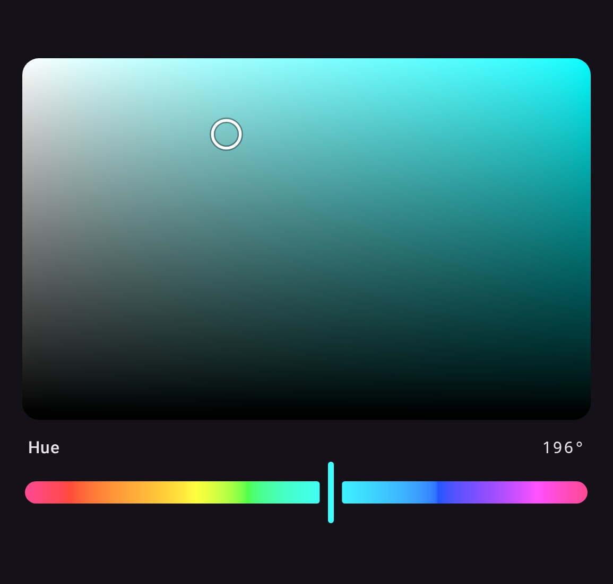

`ChannelPlane(state, x, y)` picks two channels of one space at once, holding the space's others,
so with a `ChannelSlider` for the rest and an `AlphaSlider` it makes a full picker.

| Plane                                                | Preview                                                                      |
|------------------------------------------------------|------------------------------------------------------------------------------|
| **HSL**<br>`ChannelPlane(state, Hsl.S, Hsl.L)`       |  |
| **Okhsl**<br>`ChannelPlane(state, Okhsl.S, Okhsl.L)` |               |
| **Okhsv**<br>`ChannelPlane(state, Okhsv.S, Okhsv.V)` |                   |

```kotlin
val state = rememberColorPickerState(ColorValue.parseCss("#9BB7D4"))

ChannelPlane(state, Hsl.S, Hsl.L, Modifier.fillMaxWidth().height(220.dp))
ChannelSlider(state, Hsl.H)
```

`x` runs left to right and `y` bottom to top, each over its channel's reference range.

## How a plane is drawn

HSL's S × L and HSV's S × V are drawn exactly, with two gradients. HSL's is a horizontal
grey-to-hue ramp under a white / transparent / black overlay: the color at lightness L is the
mid-lightness color blended toward white by `2L-1` above the middle and toward black by `1-2L`
below it, which is what compositing the overlay computes. Every other pair has no such identity,
so it is sampled on a grid, measured for each of the library's planes, and drawn scaled. The grid
is rebuilt off the main thread when a held channel changes, except on the web, where it shares the
one thread with input and yields to it every few rows.

`LocalPlaneRendering` decides how. `PlaneRendering.Fast`, the default, shares the rows among up to
four threads, builds Okhsl's S × L as two smaller grids that meet on its crease, and draws each
sample where its grid is measured. `PlaneRendering.Canonical` is the reference it is tested against.

The surface is **not** mirrored in right-to-left layouts, unlike the sliders. It maps a
color space rather than showing progress.

## Keyboard and screen reader

A plane is reachable without a pointer. It takes focus — by tab or by being pressed — and the
arrow keys move each channel by its `step`, or its `pageStep` with Shift held. An arrow it cannot
use, because that edge is already reached, is passed on, so focus can still leave on a device
driven by a D-pad alone. The focus ring is drawn only while the input mode is keyboard, so a
finger that took focus by pressing the surface does not leave one behind. A screen reader has no
gesture for two degrees of freedom, so each direction is offered as a named action instead,
stepping by `pageStep` because an action menu has no modifier key to hold:

```kotlin
ChannelPlane(
    state = state,
    x = Hsl.S,
    y = Hsl.L,
    actionLabels = PlaneActionLabels(          // read aloud, so localize them
        increaseX = "Sättigung erhöhen",
        decreaseX = "Sättigung verringern",
        increaseY = "Helligkeit erhöhen",
        decreaseY = "Helligkeit verringern",
    ),
)
```

Passing `null` drops the actions and leaves the plane readable but not adjustable.

## Custom position indicator

`thumb` replaces the position indicator. It reads the plane's `InteractionSource` from its scope —
which carries focus as well as drag, so a replacement can mark keyboard focus the way the default
indicator does, with a second ring — and, on a `ChannelPlane`, the channels and the color under it:

```kotlin
ChannelPlane(state, Hsl.S, Hsl.L, thumb = { MyIndicator(interactionSource, thumbColor) })
```
