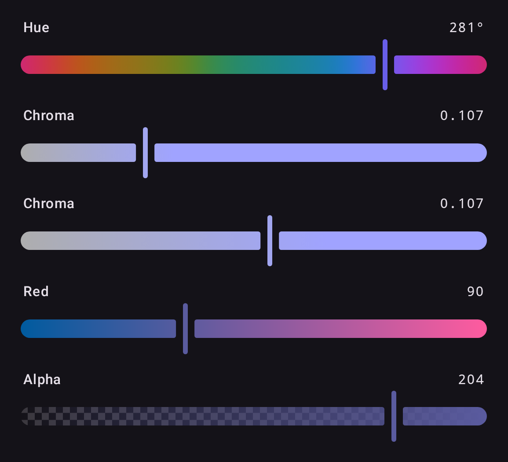

`ChannelSlider(state, channel)` is a slider for one channel of any space, and `AlphaSlider(state)`
one for alpha. Compose any set of them against a shared state:

```kotlin
ChannelSlider(state, Okhsl.H)
ChannelSlider(state, Oklch.C)                       // 0 to 0.4, CSS's reference range
ChannelSlider(state, Oklch.C, range = 0.0..0.2)     // a narrower track
ChannelSlider(state, Srgb.R)
AlphaSlider(state)
```

{ width="440" }

- The thumb sits at the channel's displayed value, so a grey's hue slider shows the hue last
  chosen. A value outside `range`, such as OkLCh chroma 0.5 or extended sRGB, pins the thumb to
  that end while the label keeps its true number; it changes only when the user moves the slider.
- `Contextual` draws each point of the track as the color the slider would make there;
  `Independent` holds the other channels at clear colors of middle lightness. Either way the track
  is computed in the channel's space and brought into sRGB by chroma reduction.
- Left and Right move by the channel's `step` and Page Up and Page Down by its `pageStep`: a degree
  and ten on a hue, 1/255 and 17/255 on an RGB channel, 0.001 and 0.01 on OkLCh chroma. Home and End
  jump to the ends of `range`, and Up and Down are left for moving focus. A screen reader steps by
  `step` too.
- `AlphaSlider` edits alpha alone and keeps the color's space. A missing alpha reads 0, as CSS reads
  `none`.

## Labels and semantics

Sliders expose slots and semantics for customization:

```kotlin
ChannelSlider(
    state = state,
    channel = Hsl.H,
    label = { ColorPickerDefaults.SliderLabel("Farbton") },          // leading label slot (null to hide)
    valueLabel = { ColorPickerDefaults.SliderValueLabel("200°") },   // trailing value slot (null to hide)
    semanticLabel = "Farbton",                                       // accessibility label
    semanticValueText = "200 Grad",                                  // accessibility value announcement
)
```

A slider's `thumb` slot replaces the thumb outright: see [Custom slider thumb](custom-thumb.md).
