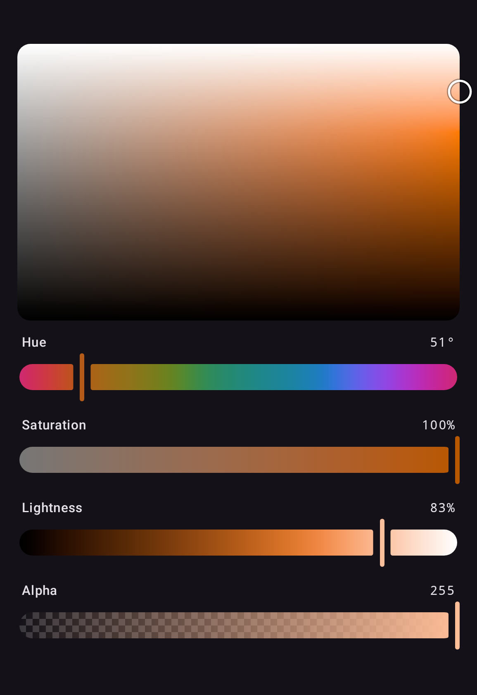

Every slider, plane and picker accepts `colors`, `shapes` and `dimensions` built with
`ColorPickerDefaults`, and `ColorSwatch` its `colors` and a `shape`; the colors and shapes derive
from `MaterialTheme` by default:

```kotlin
ColorPicker(
    state = state,
    colors = ColorPickerDefaults.colors(
        checkerboardLight = Color.White,
        checkerboardDark = Color.LightGray,
    ),
    shapes = ColorPickerDefaults.shapes(
        trackShape = RoundedCornerShape(4.dp),
        swatchShape = RoundedCornerShape(8.dp),
    ),
)
```

## ColorPickerTheme

`ColorPickerTheme` sets them for everything inside it instead, which is how a track height
reaches every slider without being a parameter on any of them:

```kotlin
ColorPickerTheme(
    dimensions = ColorPickerDefaults.dimensions(trackHeight = 24.dp),
) {
    ColorPicker(state)
    ChannelPlane(state, Okhsl.S, Okhsl.L)
}
```

{ width="440" }

A component reads the theme in its parameter defaults, so an explicit argument still wins over
whatever an enclosing `ColorPickerTheme` provided. What a `ColorPickerTheme` is not given it
leaves to the theme around it, so a `MaterialTheme` nested inside still colors the pickers under it.

`ColorPickerDefaults.colors()`, `shapes()` and `dimensions()` keep every value you leave out, and
each class's `copy` does the same from one you already have, such as
`ColorPickerDefaults.currentColors()`.

For a design system other than Material, see [Without Material](without-material.md).
