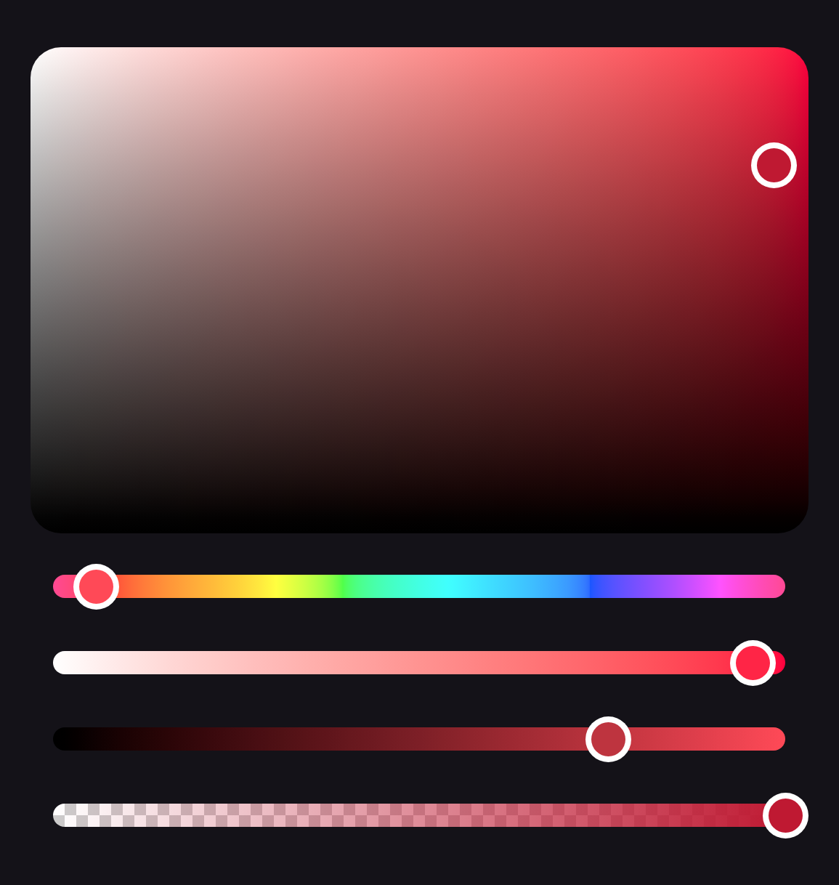

`codes.side:colorpicker-foundation` holds the same components with no look of their own. Each draws
what its slots draw, and a slot reads what it needs from a scope: a slider's position, its color and
whether it is enabled, a plane's position, a channel slider's gradient. Dragging, the keyboard, a
screen reader and the picker's disabled state work as they do in the Material components, which are
built on these. [Setup](setup.md) shows what each artifact holds.

| Material 3          | Foundation                                                                               |
|---------------------|------------------------------------------------------------------------------------------|
| `ColorPicker`       | `BasicColorPicker`                                                                       |
| `ChannelSlider`     | `BasicChannelSlider`                                                                     |
| `AlphaSlider`       | `BasicAlphaSlider`                                                                       |
| `ColorSlider`       | `BasicColorSlider`                                                                       |
| `ChannelPlane`      | `BasicChannelPlane`                                                                      |
| `ColorPlane`        | `BasicColorPlane`                                                                        |
| `ColorSwatch`       | a clip, `Modifier.checkerboard` and a background                                         |
| `ColorComparison`   | `BasicColorComparison`                                                                   |
| `ColorPickerDialog` | `BasicColorPickerDialogContent` over a `ColorPickerDialogState`, in a window of your own |

## A picker without Material

`BasicColorPicker` hands each slot a part, the state and the channel or the plane's axes, and a
library slider or plane in a slot takes the picker's `coloringMode` and reports to its
`onValueChangeFinished` without being told. A picker with round thumbs and pill tracks, and nothing
from Material:

```kotlin
BasicColorPicker(
    state = state,
    space = Okhsv,
    plane = { part ->
        BasicChannelPlane(
            part.state, part.x, part.y,
            Modifier.fillMaxWidth().aspectRatio(1.6f),
            shape = RoundedCornerShape(16.dp),
            thumb = { RoundThumb(thumbColor) },
        )
    },
    channelSlider = { part ->
        BasicChannelSlider(
            part.state, part.channel, Modifier.fillMaxWidth(),
            track = { Box(Modifier.fillMaxWidth().height(12.dp).clip(CircleShape).background(gradient)) },
            thumb = { RoundThumb(thumbColor) },
        )
    },
    alphaSlider = { part ->
        BasicAlphaSlider(
            part.state, Modifier.fillMaxWidth(),
            track = {
                Box(
                    Modifier.fillMaxWidth().height(12.dp).clip(CircleShape)
                        .checkerboard(Color.White, Color.LightGray)
                        .background(gradient),
                )
            },
            thumb = { RoundThumb(thumbColor) },
        )
    },
    spacing = 16.dp,
)

@Composable
fun RoundThumb(color: Color) {
    Box(Modifier.size(24.dp).background(Color.White, CircleShape).padding(3.dp).background(color, CircleShape))
}
```

{ width="440" }

## The disabled state

A slot reads from its scope whether it is enabled. What lies outside every scope reads
`LocalColorPickerEnabled` to look disabled with the picker: a label drawn above a slider, or the field
a `BasicChannelPlane` paints, which it leaves undimmed when disabled. The sample app's *Built on
foundation* section runs a picker like this one, its plane dimmed through its modifier.
